# Guía de mantenimiento

Cómo funciona la web de Poza Studios, cómo actualizar su contenido y cómo cambiar sus funcionalidades sin romper nada.

> Los diagramas están en Mermaid. GitHub los muestra directamente. En la vista previa de VS Code hace falta una extensión como *Markdown Preview Mermaid Support*.

**Índice**

1. [Cómo funciona](#1-cómo-funciona)
2. [Mapa de páginas](#2-mapa-de-páginas)
3. [Cómo se carga cada página](#3-cómo-se-carga-cada-página)
4. [Flujo de trabajo general](#4-flujo-de-trabajo-general)
5. [Actualizar contenido](#5-actualizar-contenido)
6. [Sistema visual](#6-sistema-visual)
7. [Cambiar funcionalidades](#7-cambiar-funcionalidades)
8. [Comprobar los cambios](#8-comprobar-los-cambios)
9. [Publicar con git](#9-publicar-con-git)
10. [Solución de problemas](#10-solución-de-problemas)
11. [Referencia de ficheros](#11-referencia-de-ficheros)

---

## 1. Cómo funciona

Es un sitio estático sin compilación. Las cuatro páginas HTML son esqueletos vacíos; su JavaScript lee los datos (JSON y Markdown) y genera el contenido en el navegador.

La regla que conviene recordar: **el contenido se cambia en los datos; el código solo se toca para cambiar cómo se muestra.**

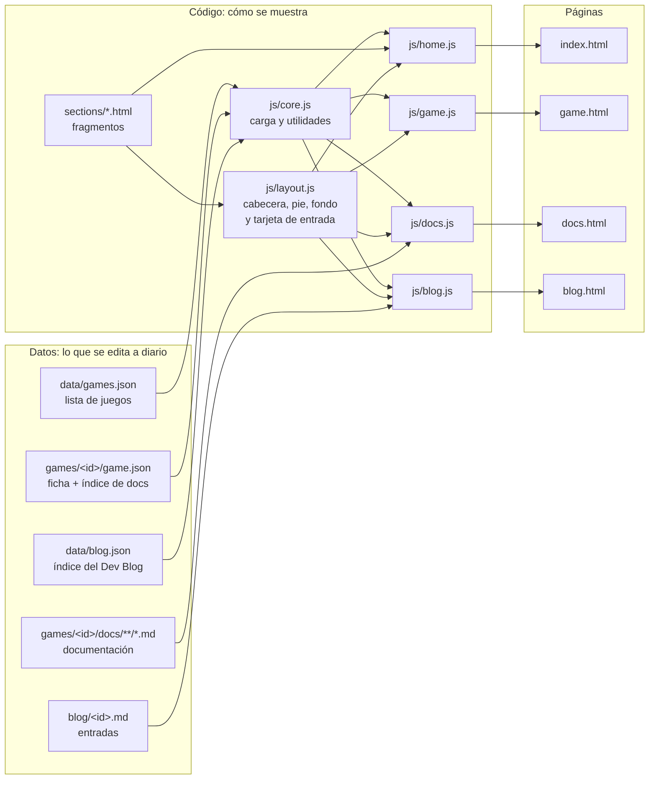

Consecuencias prácticas:

- Las páginas cargan sus datos con `fetch`, así que **hay que servirlas por HTTP**. Abrir `index.html` con doble clic muestra la página vacía (ver [sección 8](#8-comprobar-los-cambios)).
- Un juego solo existe para la web si su id está en [data/games.json](data/games.json); una entrada del blog, si está en [data/blog.json](data/blog.json). La carpeta `games/_plantilla` no aparece nunca porque no está en la lista.
- La documentación y el blog convierten Markdown con la librería `marked`, cargada desde un CDN en [docs.html:30](docs.html#L30) y [blog.html:23](blog.html#L23).

---

## 2. Mapa de páginas

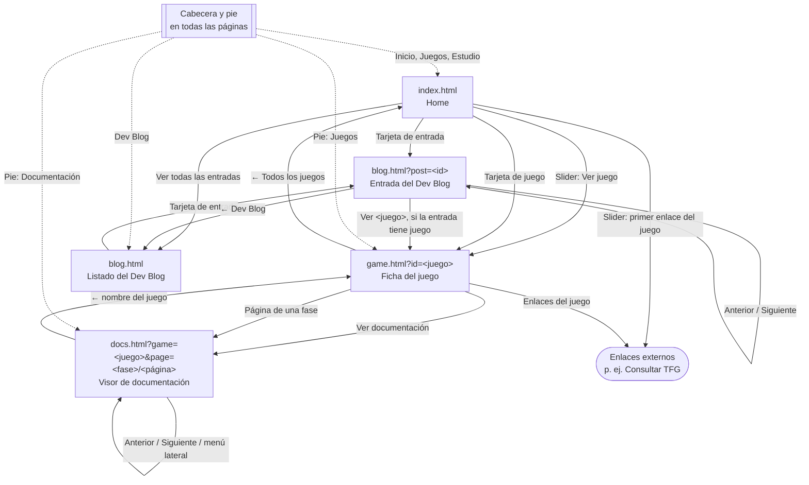

Los parámetros de la URL deciden qué se muestra:

| Página | Parámetros | Si falta o es incorrecto |
|---|---|---|
| `game.html` | `id`: id del juego | Mensaje «No encontrado» |
| `docs.html` | `game`: id del juego; `page`: `fase/página` | Sin `page`, abre la primera página. Juego incorrecto: «No encontrado» |
| `blog.html` | `post`: id de la entrada (opcional) | Sin `post`, muestra el listado. Entrada inexistente: «No encontrado» |

### Home: `index.html`

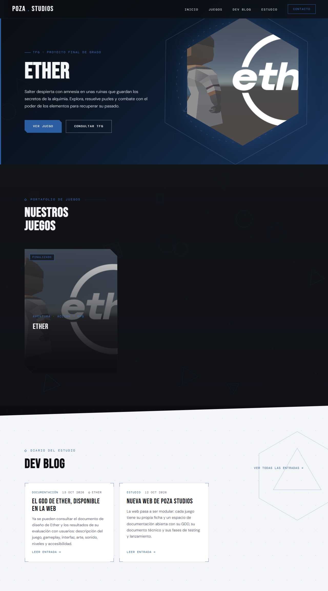

De arriba abajo: cabecera, slider de juegos destacados, rejilla de juegos, Dev Blog (sección clara con las tres últimas entradas), cifras, sobre el estudio y pie.

### Ficha del juego: `game.html`

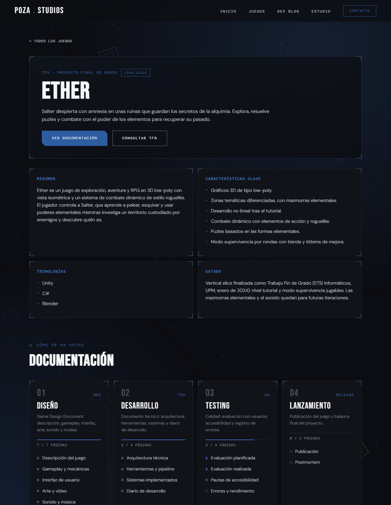

Cabecera con estado y botones, cuatro tarjetas (resumen, características, tecnologías y estado) y las fases de documentación con su progreso.

### Visor de documentación: `docs.html`

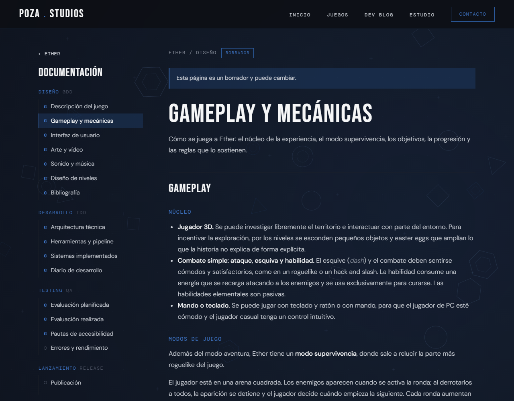

Menú lateral con todas las fases y páginas, aviso de estado, contenido en Markdown y enlaces anterior/siguiente al final.

### Dev Blog: `blog.html`

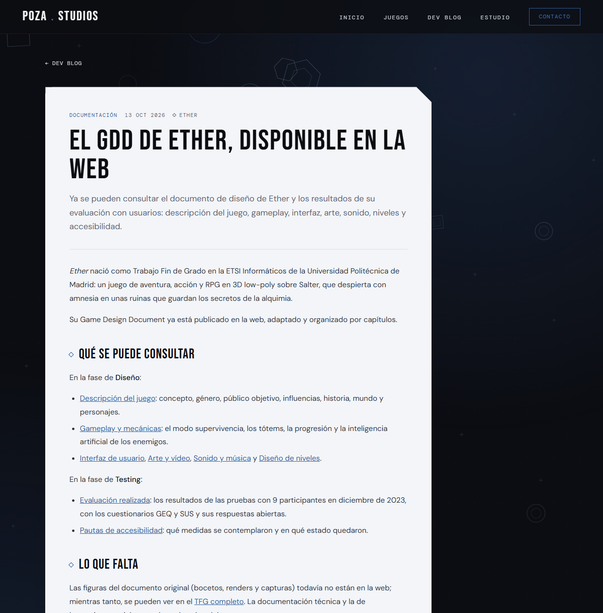

Sin parámetros, el listado de entradas en una hoja clara. Con `?post=<id>`, la entrada: cabecera con etiqueta, fecha y juego, texto en Markdown, botón al juego si lo tiene y enlaces a la entrada anterior y la siguiente.

---

## 3. Cómo se carga cada página

Todas siguen el mismo patrón: el HTML trae contenedores vacíos, el script cargado como módulo pide los datos, `initLayout` monta el fondo animado, la cabecera y el pie, y la página pinta su contenido.

### Home

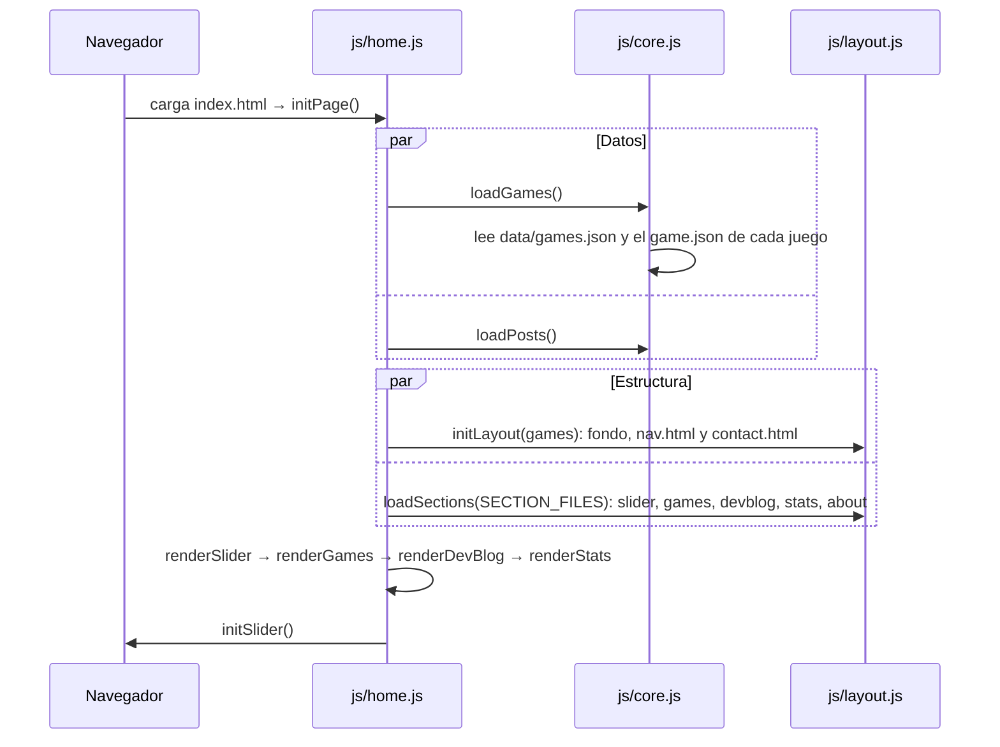

| Paso | Dónde |
|---|---|
| Arranque | [js/home.js:127](js/home.js#L127) `initPage` |
| Fragmentos que se cargan | [js/home.js:8](js/home.js#L8) `SECTION_FILES` |
| Contenedores en el HTML | [index.html:13-19](index.html#L13-L19) |
| Slide de un juego (con su portada en hexágono) | [js/home.js:33](js/home.js#L33) `renderSlide` |
| Slider (juegos con `featured: true`) | [js/home.js:54](js/home.js#L54) `renderSlider` |
| Tarjetas de juegos | [js/home.js:68](js/home.js#L68) `renderGameCard` |
| Últimas entradas del Dev Blog (`HOME_POSTS`, 3) | [js/home.js:100](js/home.js#L100) `renderDevBlog` |
| Cifras | [js/home.js:109](js/home.js#L109) `renderStats` |
| Comportamiento del slider | [js/slider.js:1](js/slider.js#L1) `initSlider` |

### Ficha del juego

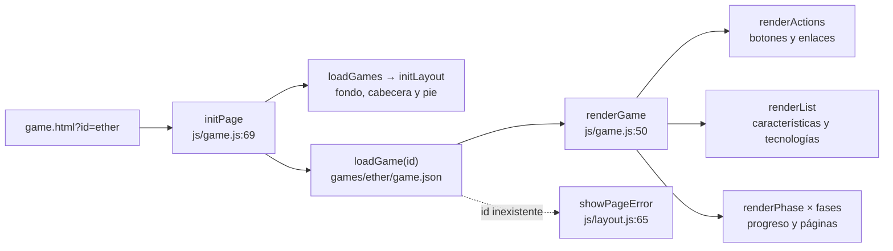

### Visor de documentación

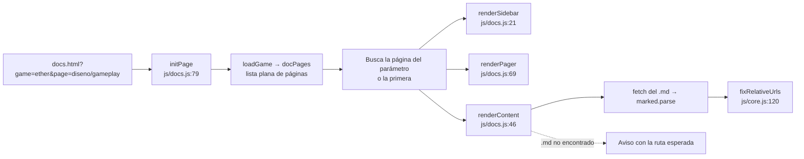

### Dev Blog

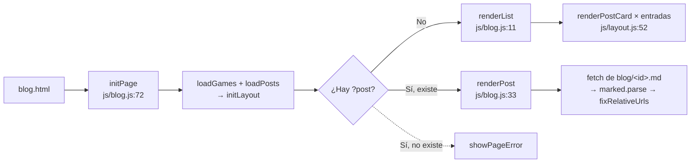

---

## 4. Flujo de trabajo general

Cualquier cambio, de contenido o de código, sigue el mismo ciclo:

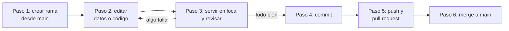

Antes de editar, decide qué tipo de cambio es:

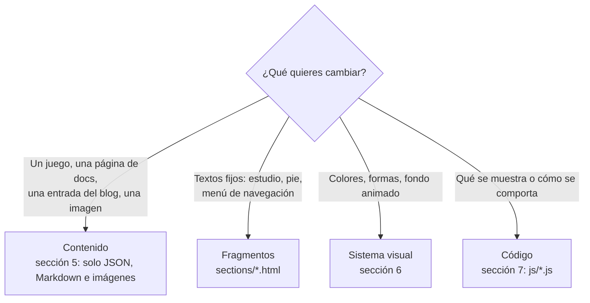

---

## 5. Actualizar contenido

Nada de esta sección requiere tocar HTML ni JavaScript.

### 5.1 Añadir un juego

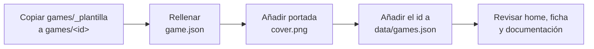

1. Copia [games/_plantilla](games/_plantilla) a `games/<id>`. El id solo admite minúsculas, números y guiones (`mi-juego`); lo valida `ID_PATTERN` en [js/core.js:3](js/core.js#L3).
2. Rellena `games/<id>/game.json`. Los campos están descritos en el [README](README.md#campos-de-gamejson).
3. Guarda la portada en la misma carpeta y pon su nombre en `cover`. Se usa en la tarjeta y, recortada en hexágono, en el slider. Si lo dejas vacío, la tarjeta usa un fondo genérico y el slide no lleva imagen.
4. Añade el id a [data/games.json](data/games.json). **El orden de esa lista es el orden en que aparecen los juegos.**
5. Si quieres que salga en el slider, pon `"featured": true`.

Los enlaces externos van en `links`. Solo se muestran los que tenga cada juego: por eso «Consultar TFG» aparece en Ether y no en los juegos creados desde la plantilla, que trae `links` vacío.

### 5.2 Escribir o actualizar documentación

Cada página tiene un estado en `game.json` que controla el aviso del visor, el punto del menú, la barra de progreso de la ficha y la cifra de «Páginas documentadas» de la home.

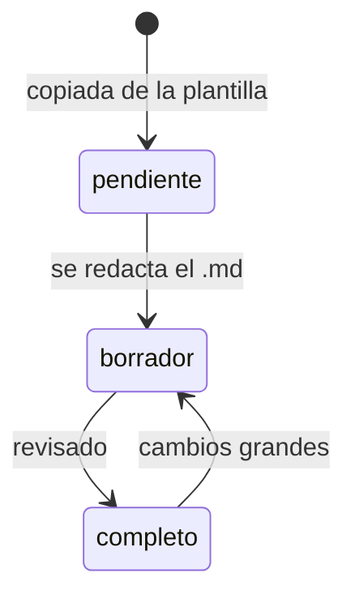

| Estado | Aviso en el visor | Cuenta como documentada |
|---|---|---|
| `pendiente` | «Todavía no se ha redactado» | No |
| `borrador` | «Es un borrador y puede cambiar» | Sí |
| `completo` | Ninguno | Sí |

Para escribir una página:

1. Edita `games/<id>/docs/<fase>/<página>.md`. Mantén los encabezados de la plantilla y sustituye las frases guía en cursiva.
2. Cambia su `status` en `games/<id>/game.json`. **Cambiar el estado sin escribir el `.md` hace que la plantilla vacía cuente como documentada.**

Para añadir una página o una fase nueva a un juego:

1. Añade la entrada en `docs` de su `game.json` (`id`, `title`, `status`).
2. Crea el fichero en `docs/<id-fase>/<id-página>.md`. Si prefieres otra ruta, indica `"file"` en la entrada; la resolución está en [js/core.js:69](js/core.js#L69) `docFileUrl`.

### 5.3 Publicar en el Dev Blog

El Dev Blog es el sitio de las novedades del estudio: avances, decisiones de diseño, documentación nueva. No hay una sección aparte de «novedades».

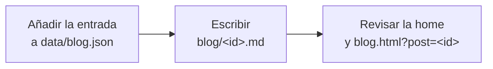

1. Añade la entrada a [data/blog.json](data/blog.json). Se ordenan solas por fecha, la más reciente primero, y la home muestra las tres primeras.

   ```json
   {
     "id": "mi-entrada",
     "date": "2026-10-20",
     "tag": "Devlog",
     "game": "ether",
     "title": "Título",
     "summary": "Resumen de una o dos frases."
   }
   ```

2. Escribe el texto en `blog/<id>.md`, **sin título**: la página ya muestra `title` y `summary` como cabecera. Empieza directamente por el primer párrafo y usa `##` para los apartados.

`game` es opcional: muestra el nombre del juego en la tarjeta y añade un botón a su ficha al final de la entrada. Una entrada sin id válido (minúsculas, números y guiones) se ignora.

### 5.4 Añadir imágenes a la documentación o al blog

1. Guarda la imagen junto al `.md` o en una subcarpeta, por ejemplo `games/ether/docs/diseno/img/hud.png` o `blog/img/captura.png`.
2. Enlázala con ruta relativa al `.md`: ``.

Las rutas relativas (de imágenes y de enlaces) se resuelven desde la carpeta del `.md` ([js/core.js:120](js/core.js#L120) `fixRelativeUrls`). Por eso, desde una entrada del blog, un enlace a una página de la web empieza por `../`: `[Ficha de Ether](../game.html?id=ether)`. Los enlaces a otras webs se abren en pestaña nueva.

### 5.5 Cambiar el estado de un juego

Edita `status` en su `game.json`. Valores: `concepto`, `pre-produccion`, `en-desarrollo`, `publicado`, `finalizado` o `pausado`. Los tres primeros cuentan como «En desarrollo» en las cifras de la home. `statusNote` es el texto libre de la tarjeta «Estado» de la ficha.

---

## 6. Sistema visual

El diseño se apoya en tres ideas que se repiten en todas las páginas: una paleta azul y gris con blanco como contraste, un fondo animado y un único lenguaje de formas geométricas.

### 6.1 Paleta

Todas las variables están en `:root` ([css/main.css:3](css/main.css#L3)). Cambiarlas ahí cambia todo el sitio.

| Grupo | Variables | Uso |
|---|---|---|
| Azules | `--sapphire`, `--sapphire-light`, `--sapphire-dark`, `--sapphire-glow` | Acentos, botones, etiquetas, franja de cifras |
| Grises | `--black`, `--gray-900` … `--gray-100`, `--white` | Fondo oscuro, paneles y textos sobre oscuro |
| Blanco papel | `--paper`, `--paper-line`, `--paper-text`, `--paper-muted`, `--pure-white` | Secciones claras, hojas de lectura del blog, tarjetas de entrada, botones secundarios |

### 6.2 Fondo animado

[js/background.js](js/background.js) dibuja en un `<canvas>` fijo, detrás de todo el contenido, una retícula triangular de puntos con alguna cruz y figuras en contorno que suben despacio. Las figuras se desplazan con el scroll y reaccionan un poco al ratón. Lo arranca `initLayout` en todas las páginas.

| Quiero… | Dónde |
|---|---|
| Cambiar las figuras | `SHAPES` ([js/background.js:5](js/background.js#L5)) y `traceShape` |
| Cambiar sus colores | `PALETTE` ([js/background.js:6](js/background.js#L6)): color RGB y peso de cada uno |
| Más o menos figuras | El cálculo de `target` en `resize`: una figura por cada 55 000 px², entre 8 y 28 |
| Densidad de la retícula | `LATTICE_SPACING` ([js/background.js:11](js/background.js#L11)) |
| Atenuarlo en una página | `<body data-background="calm">`, como en [docs.html:14](docs.html#L14) |

Para que el fondo se vea, las secciones usan fondos semitransparentes. Si una sección nueva tiene un fondo opaco, lo tapará en esa zona.

El fondo respeta la preferencia del sistema «reducir movimiento» (se queda estático, aunque acompaña al scroll) y se detiene cuando la pestaña no está visible.

### 6.3 Formas geométricas

Siempre el mismo juego de formas: **triángulo, hexágono, rombo, cuadrado y círculo**, en contorno fino. Cualquier elemento nuevo debería usar alguno de estos recursos:

| Recurso | Cómo se aplica | Dónde está |
|---|---|---|
| Marco de esquinas tipo HUD | Automático en `.project-hero`, `.project-detail-card`, `.phase-card`, `.about-card`, `.post-card` y `.paper`. Para un panel nuevo, añade su clase a las dos listas de selectores | [css/main.css:994](css/main.css#L994). Color y tamaño con `--frame-color` y `--frame-size` |
| Esquina recortada | `clip-path` con `--chamfer` en `.btn-primary`; esquinas mayores en `.project-card` y `.paper` | [css/main.css](css/main.css) |
| Rombo | Marca de todas las `.section-label`, de los `##` del blog y del juego asociado a una entrada | `.section-label::before`, `.post-body h2::before`, `.post-game::before` |
| Hexágono | Portada del juego en el slider (`.slide-visual`) y adorno giratorio (`.slide-accent`, hexágono con triángulo inscrito) | Bloque `SLIDER` de [css/main.css:139](css/main.css#L139) |
| Sección clara | Clase `section-light`: fondo papel, bordes en diagonal, retícula de puntos y un hexágono decorativo | [css/main.css:1030](css/main.css#L1030) |
| Hoja de papel | Clase `paper`: panel claro sobre el fondo oscuro, con esquina recortada | [css/main.css:1150](css/main.css#L1150) |

### 6.4 Ficheros de estilos

| Fichero | Contiene |
|---|---|
| [css/main.css](css/main.css) | Variables, fondo animado, cabecera, slider, botones, rejilla de juegos, cifras, sobre el estudio, pie, ficha base (`.project-*`), etiquetas de estado, marco HUD, secciones claras, Dev Blog y hoja de papel |
| [css/game.css](css/game.css) | Ficha del juego: botones, fases, barras de progreso y puntos de estado |
| [css/docs.css](css/docs.css) | Visor de documentación: menú lateral, aviso, Markdown sobre oscuro y paginación |
| [css/blog.css](css/blog.css) | Dev Blog: listado, entrada, Markdown sobre papel y paginación |

---

## 7. Cambiar funcionalidades

### 7.1 Añadir una sección a la home

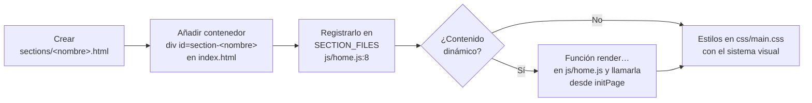

El orden de los contenedores en [index.html](index.html#L13-L19) es el orden visual. Si la sección necesita un enlace en la cabecera, añádelo en [sections/nav.html](sections/nav.html) con la forma `index.html#<id-de-la-sección>`, para que funcione también desde las otras páginas.

Para que encaje con el diseño: alterna secciones oscuras (fondo semitransparente) y claras (`section-light`), usa `.section-label` y `.section-title` para la cabecera y aplica el marco HUD a sus paneles (sección 6.3).

### 7.2 Cambiar la cabecera o el pie

Son fragmentos compartidos por todas las páginas, cargados por `initLayout` ([js/layout.js:44](js/layout.js#L44)):

- Menú: [sections/nav.html](sections/nav.html)
- Pie: [sections/contact.html](sections/contact.html). Las listas «Juegos» y «Documentación» se rellenan solas desde `data/games.json` ([js/layout.js:27](js/layout.js#L27) `renderFooterGames`); no las escribas a mano.

### 7.3 Cambiar la tarjeta de entrada del blog

La misma tarjeta se usa en la home y en el listado del blog: `renderPostCard` en [js/layout.js:52](js/layout.js#L52), con estilos en el bloque `DEV BLOG` de [css/main.css:1058](css/main.css#L1058). El número de entradas de la home es `HOME_POSTS` en [js/home.js:17](js/home.js#L17).

### 7.4 Añadir un campo nuevo a `game.json` o a `blog.json`

1. Añade el campo a [games/_plantilla/game.json](games/_plantilla/game.json) y a los juegos existentes, o a las entradas de [data/blog.json](data/blog.json).
2. Muéstralo donde toque:
   - Ficha del juego: un elemento con `id` en [game.html](game.html) y su relleno en `renderGame` ([js/game.js:50](js/game.js#L50)).
   - Home: `renderGameCard` o `renderSlide` en [js/home.js](js/home.js#L33).
   - Blog: `renderPostCard` ([js/layout.js:52](js/layout.js#L52)) o `renderPost` ([js/blog.js:33](js/blog.js#L33)).
3. Escapa siempre el texto con `escapeHtml` ([js/core.js:36](js/core.js#L36)) al construir HTML.
4. Documenta el campo en el [README](README.md).

### 7.5 Añadir un estado de juego

Añade la entrada en `GAME_STATUSES` ([js/core.js:5](js/core.js#L5)): la clave es el valor que irá en `game.json`, `label` el texto visible y `upcoming` si cuenta como «En desarrollo». Actualiza la lista del [README](README.md#campos-de-gamejson) y la [sección 5.5](#55-cambiar-el-estado-de-un-juego).

### 7.6 Añadir un estado de página de documentación

Tres sitios:

1. `PAGE_STATUSES` en [js/core.js:14](js/core.js#L14): clave y texto visible.
2. `STATUS_NOTICES` en [js/docs.js:7](js/docs.js#L7): aviso del visor (opcional).
3. Estilo del punto `.doc-dot-<estado>` en [css/game.css](css/game.css).

Si el nuevo estado debe contar como documentado, ajusta `isWritten` en [js/core.js:79](js/core.js#L79).

### 7.7 Cambiar la estructura de documentación de los juegos nuevos

Edita la plantilla: las fases y páginas en `docs` de [games/_plantilla/game.json](games/_plantilla/game.json) y los `.md` correspondientes en [games/_plantilla/docs](games/_plantilla/docs). Los juegos ya creados no cambian; si quieres aplicarlo a ellos, repite el cambio en su carpeta.

### 7.8 Actualizar `marked`

La versión está fijada en dos sitios, [docs.html:30](docs.html#L30) y [blog.html:23](blog.html#L23); cámbiala en los dos. Después revisa varias páginas de documentación (sobre todo las que tienen tablas y listas anidadas) y alguna entrada del blog. El código solo usa `marked.parse`.

---

## 8. Comprobar los cambios

1. Sirve la carpeta por HTTP. Con la extensión **Live Server** de VS Code: clic derecho en `index.html` → *Open with Live Server*. Con Node: `npx serve .`.
2. Abre la consola del navegador (F12): los errores de carga aparecen ahí con el fichero que falla.
3. Recorre esta lista:

- [ ] La home muestra el juego en el slider (si es destacado), en la rejilla y en el pie.
- [ ] La ficha abre desde la tarjeta y muestra sus datos y fases.
- [ ] Cada página de documentación abre desde la ficha y desde el menú lateral, sin «No se ha encontrado el fichero».
- [ ] Las entradas nuevas aparecen en la home y en `blog.html`, y se abren sin error.
- [ ] Las imágenes nuevas cargan.
- [ ] Las cifras de la home cuadran con los estados de `game.json`.
- [ ] El fondo animado se ve detrás del contenido y no tapa textos.
- [ ] La consola no muestra errores.
- [ ] Con la ventana estrecha (móvil) no hay desbordamientos.

---

## 9. Publicar con git

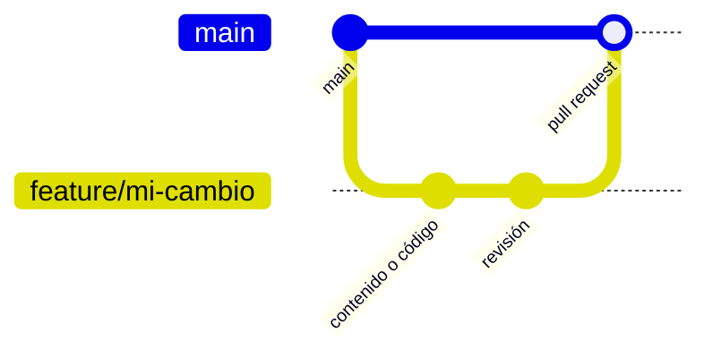

```bash
git checkout main
git pull
git checkout -b feature/<descripcion-corta>
# ...editar y comprobar...
git add .
git commit -m "Describe el cambio"
git push -u origin feature/<descripcion-corta>
# abrir pull request en GitHub y hacer merge a main
```

Cuando el merge esté hecho, borra la rama (`git branch -d feature/<...>` en local y desde GitHub en remoto) para que no se acumulen ramas antiguas.

---

## 10. Solución de problemas

| Síntoma | Causa probable | Solución |
|---|---|---|
| La página sale vacía o solo con fondo | Abierta con doble clic (`file://`) | Servirla por HTTP ([sección 8](#8-comprobar-los-cambios)) |
| Un juego no aparece en la home | Su id no está en `data/games.json`, el id tiene caracteres no válidos o su `game.json` tiene un error de sintaxis | Revisar la lista y el id; la consola indica qué `game.json` no carga |
| Desaparecen todos los juegos | `data/games.json` tiene un error de sintaxis | Validar el JSON (una coma de más es el fallo típico) |
| El Dev Blog sale vacío | `data/blog.json` tiene un error de sintaxis o las entradas no tienen `id` válido | Validar el JSON y los ids |
| «No se ha encontrado el fichero» en el visor o en una entrada | El `.md` no está donde se espera o los ids no coinciden | Revisar nombres; el aviso muestra la ruta esperada |
| Una imagen o un enlace del Markdown no funciona | Ruta escrita desde la raíz y no desde la carpeta del `.md` | Usar la ruta relativa al `.md` ([sección 5.4](#54-añadir-imágenes-a-la-documentación-o-al-blog)) |
| El slider no tiene flechas ni puntos | Solo hay un juego destacado | Es lo esperado; aparecen con dos o más |
| «Páginas documentadas» cuenta páginas vacías | Hay páginas en `borrador` o `completo` con el `.md` de plantilla | Devolverlas a `pendiente` hasta redactarlas |
| El visor o el blog muestran Markdown sin formato o en blanco | No ha cargado `marked` (sin conexión o CDN caído) | Comprobar la conexión y la URL de `marked` ([sección 7.8](#78-actualizar-marked)) |
| El fondo animado no se mueve | El sistema tiene activado «reducir movimiento», o la pestaña está en segundo plano | Es lo esperado |
| El fondo animado no se ve en una sección | La sección tiene un fondo opaco | Usar un fondo semitransparente ([sección 6.2](#62-fondo-animado)) |
| Un panel nuevo no tiene marco de esquinas | Su clase no está en las listas del marco HUD | Añadirla ([sección 6.3](#63-formas-geométricas)) |
| Los cambios no se ven | Caché del navegador | Recargar sin caché (Ctrl + F5) |

---

## 11. Referencia de ficheros

| Ruta | Para qué sirve | ¿Se edita a menudo? |
|---|---|---|
| [data/games.json](data/games.json) | Juegos publicados y su orden | Sí |
| [data/blog.json](data/blog.json) | Índice de entradas del Dev Blog | Sí |
| `blog/<id>.md` | Texto de cada entrada del blog | Sí |
| `games/<id>/game.json` | Ficha del juego e índice de su documentación | Sí |
| `games/<id>/docs/**/*.md` | Páginas de documentación | Sí |
| [games/_plantilla](games/_plantilla) | Punto de partida de un juego nuevo | Poco |
| [index.html](index.html), [game.html](game.html), [docs.html](docs.html), [blog.html](blog.html) | Esqueletos de las páginas | Poco |
| [sections/](sections) | Fragmentos HTML: cabecera, pie, estudio y contenedores de la home | Poco |
| [js/core.js](js/core.js) | Carga de datos, estados, URLs y utilidades compartidas | Al cambiar funcionalidades |
| [js/layout.js](js/layout.js) | Fondo, cabecera, pie, tarjeta de entrada y página de error | Al cambiar funcionalidades |
| [js/background.js](js/background.js) | Fondo animado | Al cambiar el diseño |
| [js/home.js](js/home.js) | Renderizado de la home | Al cambiar funcionalidades |
| [js/slider.js](js/slider.js) | Comportamiento del slider | Rara vez |
| [js/game.js](js/game.js) | Renderizado de la ficha | Al cambiar funcionalidades |
| [js/docs.js](js/docs.js) | Visor de documentación | Al cambiar funcionalidades |
| [js/blog.js](js/blog.js) | Listado y entradas del Dev Blog | Al cambiar funcionalidades |
| [css/](css) | Estilos ([sección 6.4](#64-ficheros-de-estilos)) | Al cambiar el diseño |
| [assets/mantenimiento](assets/mantenimiento) | Capturas de esta guía | Al cambiar el diseño |

Si cambias el código, revisa que las referencias de línea de esta guía sigan apuntando a la función correcta.
